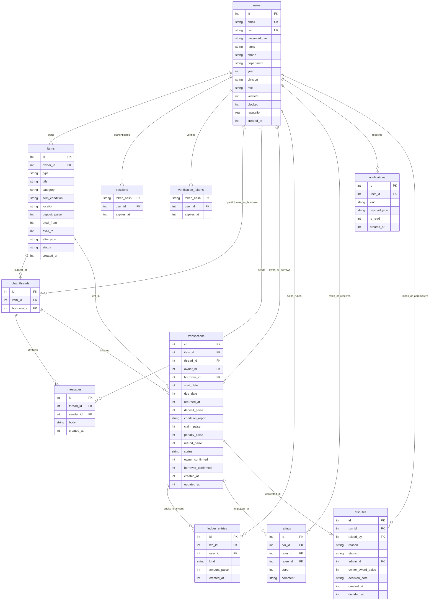

# Entity-Relationship (ER) Diagram

The following Mermaid entity-relationship diagram illustrates the SQLite database schema implemented in `db/schema.sql`.

## Key Schema Constraints & Guarantees
1. **Uniqueness**:
   - `users.email` and `users.prn` are unique.
   - `chat_threads(item_id, borrower_id)` is unique (1 thread per borrower per item).
   - `ratings(txn_id, rater_id)` is unique (one rating per participant per transaction).
   - `ux_one_live_txn_per_item`: partial unique index on `transactions(item_id)` where `status IN ('ACCEPTED', 'ACTIVE', 'OVERDUE')`.
2. **Append-Only Triggers**:
   - Updates and deletions on `messages` and `ledger_entries` are blocked via SQLite triggers.
